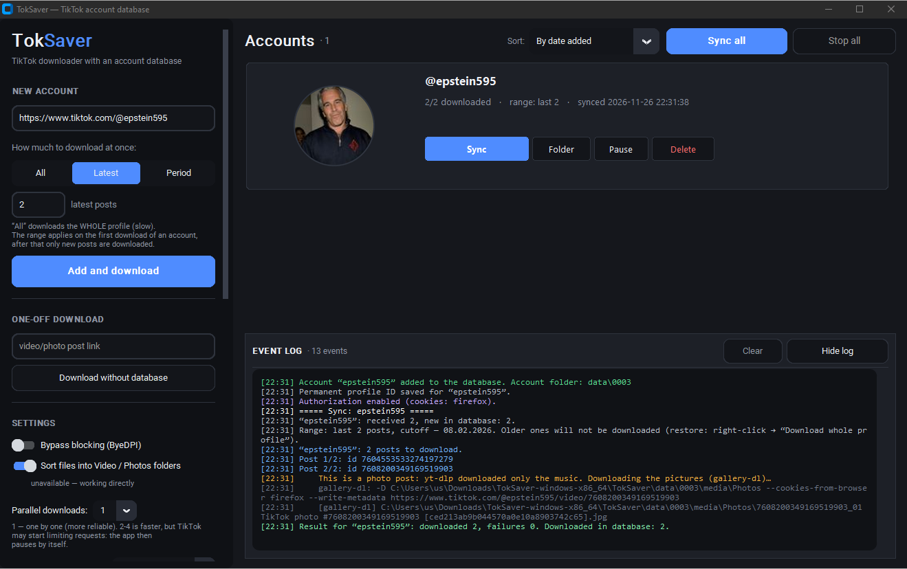

# TokSaver

Десктопный загрузчик TikTok с базой по каждому аккаунту — аналог 4K Tokkit.
Добавьте аккаунты один раз, нажмите **Синхронизировать всех** — дальше качаются только новые посты.

[English](README.md) · Русский

> **Важно.** TokSaver — независимый проект, не связан с TikTok. Сохраняйте только то, на что у вас есть право,
> и соблюдайте правила TikTok и местное законодательство.



## Возможности

- **Аккаунты с базой** — у каждого своя папка и SQLite-база; видео и фото-карусели, докачка очереди.
- **Синхронизировать всех / Остановить всех** — проверка новых постов и докачка очереди; в конце итог (новые, скачано, ошибки, объём, время).
- **Автосинхронизация** — выкл / раз в 1, 3, 6, 12 часов / каждый день в заданное время (пока программа открыта).
- **Окно постов** — список или плитки, сортировка, фильтры, превью; у фото-постов видны все картинки поста.
- **Cookies** из браузера или `cookies.txt` (запоминаются) — для закрытого/18+ контента.
- **Параллельные загрузки** (1–4) с авто-паузой, если TikTok начинает ограничивать запросы.
- Тёмная и светлая темы, цветной журнал, меню по правому клику.
- **Языки:** English, Русский, Українська, Deutsch, Français, Español.
- **Безопасность:** yt-dlp и ByeDPI проверяются по SHA-256, cookies уходят только на tiktok.com, логи очищаются от секретов.

## Скачать

На странице **Releases** возьмите архив для своей системы, распакуйте и запустите `TokSaver`
(`TokSaver.exe` в Windows). Устанавливать ничего не нужно.

| Система | Файл | Примечание |
|---|---|---|
| Windows 10/11 | `TokSaver-windows-x86_64.zip` | SmartScreen может предупредить о неподписанной программе: *Подробнее → Выполнить в любом случае*. |
| macOS (Apple Silicon) | `TokSaver-macos-arm64.zip` | Без подписи: правый клик → *Открыть* или `xattr -dr com.apple.quarantine TokSaver`. |
| Linux x86-64 | `TokSaver-linux-x86_64.zip` | При необходимости `chmod +x TokSaver`. Нужен графический сеанс. |

Данные (`data/`, `bin/`, `logs/`) создаются рядом с программой — папку можно переносить.

## Запуск из исходников

Нужен Python 3.10+ с tkinter.

```bash
python main.py        # Windows: двойной клик по «Запустить.bat»
```

При первом запуске создаётся собственное окружение `.venv` с зависимостями из `requirements.txt`
(отключить: `TOKSAVER_NO_VENV=1`). В Linux сначала `sudo apt install python3-tk`. ByeDPI используется только в Windows.

## Сборка exe и тесты

```bash
pip install -r requirements.txt pyinstaller
python build_exe.py
python -m pytest tests
```

Тег вида `v1.0.0` запускает GitHub Actions: собираются версии для Windows, macOS и Linux и прикрепляются к релизу.

Подробное описание: [docs/FEATURES.ru.txt](docs/FEATURES.ru.txt).
